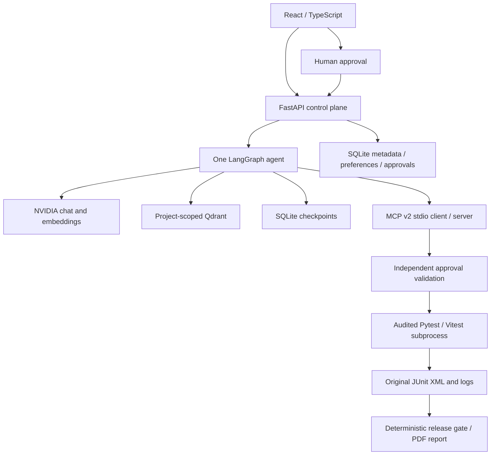

# TestForge AI

An academic, local-first agentic QA platform for Scenario 26. Glass panels, neo-brutalist borders and offset shadows surround an evidence-driven workflow: import → discover → retrieve → plan → approve → execute → reflect → report.

## Start

Requirements: Python 3.12+, Node 22.13+ (Node 24 tested), npm, and NVIDIA API access.

```sh
python3 -m venv .venv
.venv/bin/pip install -r requirements.lock.txt
npm ci
cp .env.example .env  # only on a fresh checkout; do not overwrite configured credentials
chmod 600 .env
# Set NVIDIA_API_KEY in .env. Never put it in a NEXT_PUBLIC variable.
./scripts/start-local.sh
```

Open http://127.0.0.1:5173. FastAPI runs at http://127.0.0.1:8010; interactive API documentation is at /docs on that port. Both servers bind to loopback. This is a single-user academic demonstration, not a multi-tenant public service. Stop the start script with Ctrl-C.

The supplied key is already configured in the ignored, owner-readable `.env` on this machine. It is never sent to the browser or copied into committed source. Runtime test processes receive a restricted environment without provider credentials.

## Working academic scope

- React/TypeScript interface with project overview, safe ZIP import, repository inventory/AST symbols, knowledge sources, agent chat, approvals, execution evidence, release reports and memory inspection.
- FastAPI typed request handling with SQLite records, audit events, approvals, runs and project-scoped preferences.
- **One LangGraph StateGraph**, with parse/context/retrieval/reasoning/planning/approval/MCP/evaluation/replanning/response nodes. Durable SQLite checkpoints use project + thread keys.
- Live NVIDIA chat and embedding integrations. Model IDs are configurable; defaults were verified with real API requests. Retrieval uses measured 2,048-dimensional embeddings and local Qdrant. No lexical fallback is presented as semantic retrieval.
- Six synthetic knowledge documents, deterministic chunk IDs, revision hashes, source paths, line ranges, quoted evidence and similarity scores. Tiny demo documents remain intact; longer documents use overlapping line windows.
- Official **MCP Python SDK v2** over stdio. Every execution client connection performs actual `list_tools` and `call_tool`. Five tools expose inventory, discovery, suite details, execution and results.
- Single-use, expiring, snapshot-bound approval enforced independently by the MCP runner. Duplicate approval submissions return the same queued run. Changed snapshots and unapproved suites fail closed.
- Real Pytest and Vitest execution, original JUnit XML, stdout/stderr, normalized test cases, exit codes, timestamps and artifact downloads. Bounded replanning proposes another suite with a new pending approval.
- Deterministic release policy: required acceptance failures → NO-GO; missing/error/timeout evidence → INSUFFICIENT EVIDENCE; both required suites passing → GO for demo scope only.
- PDF release report, JSON report, ZIP evidence export and browser transcript export.

## Demonstrate in five minutes

1. Open **Overview**, then **Repository**. Inspect Python and TypeScript and the two allowlisted suites.
2. In **Knowledge**, click **Index documents**. Inspect a source and use the retrieval debugger for “expired coupon”.
3. In **Agent workspace**, ask “Analyze this project and test checkout.” Inspect cited evidence and graph transitions.
4. In **Approvals**, inspect the suite and snapshot, then **Approve & run** and confirm. The backend Pytest suite intentionally returns **4 passed / 1 failed**. The failure is real: DEF-12 accepts an expired coupon.
5. Inspect the JUnit XML and failure detail in **Test runs**. A failed backend run proposes an independent frontend suite; approve it separately. Vitest has three independent passing cases.
6. Ask “Why did that test fail?” in the same thread. The agent receives the actual last run plus the requirements.
7. Say “For this project, prefer checkout_regression.” Create a **New session** and ask “Which suite do I prefer?” Verify the separate preference in **Memory**.
8. Open **Release report**. A passing frontend suite cannot override the critical backend failure. Export the PDF and evidence ZIP.

## Tests and evidence

```sh
npm run typecheck
npm run test:system
npm run build
```

The system tests cover ZIP traversal/symlinks/quotas/secrets, real failed fixture execution, XML normalization, unauthorized/expired/replayed approvals, snapshot mismatch, unknown suites, timeout/crash handling, deterministic gates, actual MCP discovery/calls, persistent checkpoints/preferences and bounded replanning. Provider-independent memory tests use labeled stubs; the live smoke script verifies the actual NVIDIA endpoints separately.

```sh
.venv/bin/python scripts/live-smoke.py
```

The smoke script writes actual LLM/RAG/memory/MCP/run evidence under `logs/` and a sample report under `output/pdf/`. It operates against a running local backend and clearly records its approvals as automated verification.

## Architecture



The application data directory (`data/`) is ignored. Preserve it to retain sessions, preferences and artifacts. A single API worker owns the Qdrant local store; do not start multiple workers. Uploaded files and document content are untrusted evidence. The model has no arbitrary shell tool and cannot approve its own proposed plan.

## Prompt design

The prompt in `services/agent.py` explicitly separates specifications, measured observations and inference; requests document citations; limits suite selection to an allowlist; treats repository instructions as data; and reserves authorization and release decisions for deterministic services. The model returns JSON (`answer`, `intent`, `suite_id`); the backend validates intent and suite identifiers before persisting any plan. Explicit preferences are recognized separately from document content.

## Blueprint alignment and limits

See `IMPLEMENTATION.md` for the full requirement map. The PDF is a planning blueprint, not evidence that all commercial features exist. Its P0 academic track is the implementation target. The source assignment/instructor scenario pack is not attached separately; the six documents and checkout scenario are explicitly synthetic.

P1/P2 features remain roadmap items: GitHub/private repository import, arbitrary uploaded-code execution, isolated microVM/container pools, Semgrep, Tree-sitter, extra language runners, organizations/RBAC, CI/CD, billing, retention/SLOs and compliance certification. Folder selection uploads explicitly selected files. Typed local paths are confined to configured server roots and require a loopback connection. There is no production-safety or complete code-coverage claim.

Hosting the complete Python/MCP/test-runner architecture requires a dedicated server/runner deployment. Sites Workers cannot run the required Python subprocesses; the functional application is delivered locally instead of publishing a disconnected frontend.

## Failure handling

- NVIDIA 401/403: verify credential access. 404: model may be listed but unavailable; select a current accessible model. 429: quota/rate limit. The UI surfaces failures and does not synthesize answers.
- Embedding dimension changes: reindex with the configured model. Reindexing replaces that project's collection.
- Qdrant locked: stop the other API process; use one worker.
- Changed fixture: generate a new project snapshot before approving another run. Existing approvals are rejected.
- Runner crash/missing artifact: ERROR. Timeout: TIMEOUT. Neither means PASS.
- Uploaded repositories: analysis only; no upload can enable the audited fixture flag or suite allowlist.
- State storage is local SQLite, and runner environment filtering is not a hardened sandbox. The MVP permits only bundled, trusted code.

## Local directory access

Open **Import project** at http://127.0.0.1:5173/?view=import.

- **Choose folder** opens the system folder picker. The browser uploads the files you select to this local backend. This works for folders outside the configured path roots. Dependency folders count toward upload limits; use the backend path option for a large repository containing `node_modules`.
- **Import directory** accepts an absolute path on the same computer as the Python backend. The default allowed root is this application's directory. For example, `/Users/macbookpro/Desktop/ABM assignment 2/fixtures` works on this installation.
- To permit another project root, add `TESTFORGE_LOCAL_ROOTS=/absolute/path/to/your/projects` to the ignored `.env`, then restart `./scripts/start-local.sh`. Multiple roots use the operating system's path separator (`:` on macOS). The UI shows the currently allowed roots.

The backend creates a separate immutable analysis snapshot; it does not write to the source directory or run its scripts. Symlinks, hardlinks, binary and secret-like files, dependency folders and generated runtime folders are excluded. Quotas: 1,000 accepted files, 2 MB per file, 25 MB total unpacked, 10 MB compressed. Missing paths, paths outside allowed roots, invalid browser origins and non-local hosts are rejected.

Imported projects support inventory, document indexing and agent analysis; arbitrary local tests remain unavailable until an isolated runner is implemented. Indexing/agent analysis sends approved document content and relevant evidence to the configured NVIDIA APIs. Browser transparency is rendered over the application's wallpaper; it does not expose other desktop applications behind the browser window. Adjust panel fill in the profile menu's **Configuration → Appearance** section.

## Interactive evidence views

The overview now contains a live, projected 3D evidence map: drag to orbit, zoom, pause/play, reset, and select nodes for source details. Nodes are assembled from the selected project's file inventory, knowledge documents, audited suites and actual runs; the map shows project associations, not inferred code dependencies. Automatic rotation respects reduced-motion preferences.

Click a repository-composition segment to inspect counts and filter source files. The test-history chart supports suite filtering, keyboard inspection, tooltips and navigation to original run evidence. An untested project has an empty history chart rather than illustrative results.

Fixed project stack badges, prominent snapshot hashes, demo-specific prompt suggestions, fixed requirement denominators and window traffic-light decorations have been removed. Requirements are discovered from each project's documents (`R-…` / `REQ-…`); fixture defaults are not applied to imported repositories. Snapshot fingerprints remain in backend approval records and downloadable provenance artifacts.

## Repeatable acceptance checks

With the local app running, `npm run test:live` verifies the real NVIDIA → retrieval → agent → approval → MCP → Pytest/Vitest → memory → report flow. `npm run test:browser` exercises desktop/mobile screens, 3D/charts, imports, citations, memory, appearance settings, approval/rejection, actual test execution and exports. Browser results are written to `output/qa/browser-verification.json`, including failures. It requires Playwright from a local install or the Codex bundled runtime; `TESTFORGE_PLAYWRIGHT_MODULE` can override that module path.

Required skipped tests produce INCOMPLETE evidence and cannot produce GO, even if a runner exits with code zero. The current verification details and any limits are recorded in `VERIFICATION.md`.
